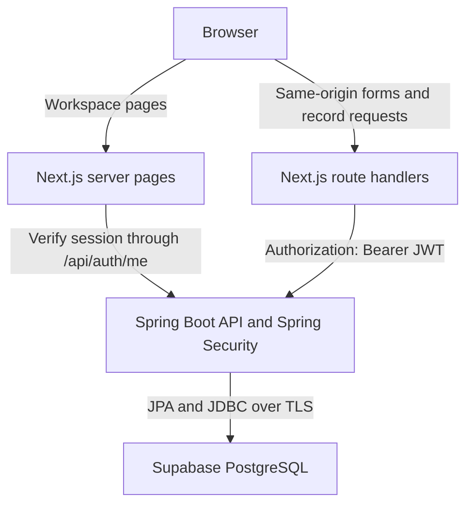

# System architecture

The application is implemented as a Next.js interface and server-side API layer,
a Spring Boot REST API, and a Supabase PostgreSQL database. Authentication is
implemented by Spring Security with application-issued JWTs; it does not use
Supabase Auth.

## Request flow

Browser requests go to the frontend origin. Next.js forwards approved API
requests to Spring Boot; database credentials and the signing secret stay on
the backend. The browser has no direct database connection.

## Components and responsibilities

| Component | Responsibility |
|---|---|
| Next.js server pages / `ProtectedWorkspace` | Verify the current session before rendering each protected workspace page |
| Next.js `/api/auth/*` handlers | Login/registration relay, HttpOnly cookie, logout, and session checks |
| Next.js `/api/data/[...path]` handler | Allowlisted student/course routes; forwards the cookie token as a Bearer header |
| `AuthProvider` | Account display, role-based UI, session expiry, and cross-tab logout |
| Shared record components | Search, sorting, client-side pagination, dialogs, validation feedback, and responsive cards/tables |
| Spring controllers | HTTP contracts and validated request DTOs |
| Spring services | Business rules, duplicate handling, BCrypt verification, and token creation |
| Spring Security resource server | JWT signature/claims validation and USER/ADMIN authorization |
| JPA repositories and entities | Persist users, students, and courses in the `app` schema |

## Authentication and authorization

Registration always creates a USER account and hashes its password with BCrypt
(cost 12). Login returns a signed HS256 JWT to Next.js. The token contains a
numeric user ID, role, issuer, issue time, and a 15-minute expiry. Responses never
expose password hashes.

Next.js stores the token in an HttpOnly, SameSite=Lax cookie that is Secure in
production. Client code receives safe user/session metadata. Next.js reads token
metadata for display and expiry; Spring verifies the signature and claims.

Every protected server page verifies its session through Spring's `/api/auth/me`.
Student/course requests attach the token in an explicit Authorization header.
Client-supplied Authorization headers are not forwarded by the proxy. Spring
checks authorization independently of whether a button is visible.

| Action | Anonymous | USER | ADMIN |
|---|---|---|---|
| Register, login, backend health | Allowed | Allowed | Allowed |
| Read own `/api/auth/me` | 401 | Allowed | Allowed |
| Read students/courses | 401 | Allowed | Allowed |
| Create/update/delete students/courses | 401 | 403 | Allowed |

Mutating browser requests require the exact frontend Origin and reject
cross-site fetches. Spring's stateless Bearer API disables cookie-based CSRF
handling; Next.js enforces the browser-origin check. Backend CORS allows the
configured frontend origin.

Logout removes the frontend cookie and tells other tabs to sign out. There is
no refresh-token or server-side token-revocation store. A separately copied JWT
can remain valid until expiry; role changes also require a new login/token.

## Data and validation

`backend/sql/001_create_tables.sql` creates the `app.students`, `app.courses`,
and `app.users` tables and enables RLS. It is for a fresh database only. Hibernate
uses `ddl-auto=validate` and does not create or rewrite production tables.
Application authorization is enforced by Spring Security.

Request DTOs enforce required fields, length/email constraints, password limits,
and course credits from 1 to 30. Frontend checks provide immediate feedback;
the backend validates every request and returns safe Problem Details responses.
Database uniqueness violations return 409 without exposing internal SQL errors.

Current list APIs return complete collections. Search, sorting, and pagination
run on that loaded data. For larger datasets, add backend query/paging contracts
and separate total-count queries before claiming database-level pagination.

## Environments

| Environment | Frontend | Backend | Database |
|---|---|---|---|
| Local | Next.js on localhost:3000 | Spring Boot on localhost:8080 by default | Existing Supabase project |
| Automated HTTP tests | Production Next server on loopback:3030 | In-memory test fixture on loopback:8181 | None |
| Prepared hosting configuration | Vercel, root `frontend`, Node 22 | Render Docker web service, JDK/JRE 21 | Existing Supabase Session pooler |

`API_BASE_URL` and `APP_ORIGIN` belong to the Next.js environment. `DB_URL`,
`DB_USERNAME`, `DB_PASSWORD`, and `JWT_SECRET` belong to Spring Boot. Render
supplies `PORT`; the application falls back to 8080 locally. The Docker runtime
uses an unprivileged numeric user.

Public deployment URLs are not available yet. See [deployment](deployment.md)
for setup and [the release checklist](release-checklist.md) for verification.
